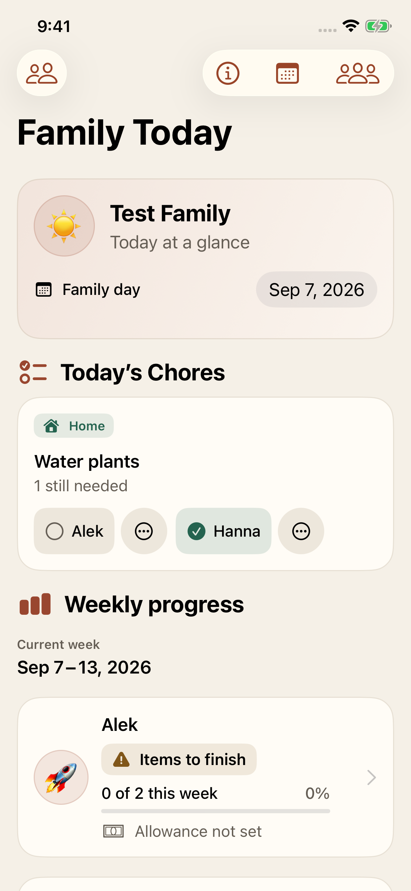
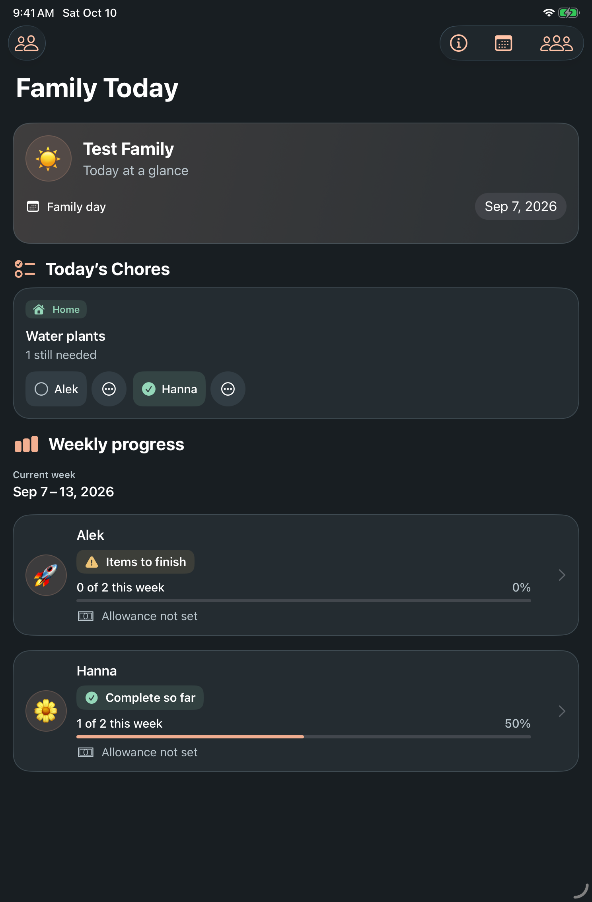

# Earned It

**A shared chore app that helps families see what needs doing, whose turn it is, and what got done.**

Native for iPhone and iPad, with SwiftUI, SwiftData, and iCloud sharing. iOS 18 or later.

[For families](#for-families) · [Privacy](#privacy) · [Engineering](#engineering) · [Development](#development) · [Release checklist](docs/app-store/release-readiness.md)

<p align="center">
  <a href="assets/screenshots/parent-today.png"></a>
  <a href="assets/screenshots/ipad-parent-dark.png"></a>
</p>

Interface previews from the current UI polish candidate, with fictional data. This visual update is pending integration into `main`; these are repository examples, not final App Store screenshots. [Capture details](assets/screenshots/README.md).

## For families

A parent creates the family, adds children, and chooses the chores. Children see their own work and mark it complete. Parents see individual contributions together, so a shared chore list still answers who did what.

| A family's day | How Earned It helps |
| --- | --- |
| Everyday responsibilities | Schedule chores by weekday and assign them to every child, one child, or children taking turns. |
| Work that comes up occasionally | Make an As Needed chore available, withdraw unused availability, or use it again after completion on the same day. |
| Plans change | Mark a scheduled chore Not Needed Today and restore an accidental current-day exemption. Parents can correct recorded work. |
| Progress over time | Review weekly work, missing items, and day-based streaks. |
| Optional allowance | Set a weekly amount and check whether all required work was completed. The app tracks eligibility without moving money or recording payments. |
| More than one device | Invite a parent or a child's exact profile with one shared link or an in-app QR scan. |

Use one device locally, or connect invited devices through iCloud. Work saves to a local journal first. Shared changes synchronize when the app connects, returns to the foreground, or refreshes; offline changes remain queued. Delivery depends on connectivity and iCloud availability.

Sharing requires an iCloud account and a network connection. Camera access is optional: an invitation link or manual code/link entry also works. On a shared child's device, the invitation binds access to that child's profile.

The [changelog](CHANGELOG.md) describes shipped source changes. [Weekly-screen examples](docs/weekly-allowance-implementation-report.md) show native Simulator captures with fictional data. Store screenshots must be recaptured and approved for the final release candidate; the older promotional preview is obsolete.

## Privacy

Earned It contains no ads, behavioral analytics, third-party telemetry, or cross-app tracking. It has no developer-operated account service or separate server for family data.

Family facts live on each device and, when sharing is enabled, in the owner's private and invited participants' shared CloudKit storage. Account membership and minimal lifecycle/security records support recovery and deletion. CloudKit read/write participants have broader technical record access than the app's parent and child controls, so invite people you trust.

The family creator can confirm **Delete All Data** in Settings. Interrupted deletion can be resumed with **Finish Deleting**. Minimal lifecycle/security records remain to prevent a deleted family from returning; authenticated deleted or revoked installations offer a confirmed **Reset App** recovery action.

Read the [privacy policy](docs/app-store/privacy-policy.md) and [implementation audit](docs/app-store/privacy-audit.md). For help, use [Support](https://github.com/jlm429/earned-it/issues) without posting family details, invitation links/codes, or Apple account information.

## Engineering

The design centers on preserving a family's history through edits, offline work, and synchronization:

- **Facts before projections.** An immutable typed journal drives daily lists, history, scores, streaks, and allowance outcomes. Stable identities connect each family, member, chore, occurrence, and contribution.
- **An explicit sync boundary.** SwiftData persists the local journal; a focused CloudKit transport exchanges facts and retries the durable outbox. SwiftData CloudKit mirroring is disabled.
- **Calendar-aware rules.** Civil dates use the household's fixed Gregorian timezone. Configuration revisions, assignments, and completions remain separate so an edit does not silently rewrite yesterday.
- **Occurrence-aware chores.** Distinct As Needed uses retain their own IDs and completion history. Deterministic ordering and control heads resolve concurrent actions. A versioned journal capability blocks incompatible writes.
- **Central permissions.** Store and permission services enforce invited-profile actions. One-time invitations, account membership recovery, and deletion use exact identity and generation checks.
- **Native, testable UI.** SwiftUI uses semantic controls, Dynamic Type, accessibility identifiers, and text/symbols alongside status colors. XCTest exercises domain and transport behavior; focused XCUITest flows exercise persistence and interactions.

See the [technical overview](docs/technical-overview.md) and [authoritative household architecture](docs/shared-household-architecture.md). The [final audit](docs/final-release-readiness.md) separates current code/test evidence from the signed two-account and physical-device checks still required for release.

## Development

Open `EarnedIt.xcodeproj` in a full Xcode installation with an available iOS Simulator runtime. The repository workflows select Xcode 26.6 and iOS 26.5; the final audit also built with Xcode 27.0. Check your installed destinations with `xcrun simctl list devices available`.

Run the domain suite with the `EarnedItCI` scheme, replacing the destination with an available iPhone Simulator:

```sh
xcodebuild test -project EarnedIt.xcodeproj -scheme EarnedItCI \
  -destination 'platform=iOS Simulator,name=iPhone 17,OS=26.5' \
  -derivedDataPath /tmp/earned-it-domain-derived \
  -parallel-testing-enabled NO CODE_SIGNING_ALLOWED=NO
```

`EarnedIt` includes the UI-test target. Use that scheme with a focused `-only-testing:EarnedItUITests/EarnedItUITests/<testName>` selector. Debug UI tests use their own store and compile-gated fixtures; Release starts without sample families or test controls.

Check release helpers without signing material:

```sh
./scripts/test-build-number.sh
./scripts/test-app-store-profile-entitlements.sh
```

The entitlement helper tests use synthetic fixtures. Simulator and transport-double tests do not establish signed CloudKit sharing. Signing, production schema verification, store metadata, screenshots, distribution, and submission remain human release actions documented in the [release checklist](docs/app-store/release-readiness.md).

## License and artwork

The source is published without an open-source license. Public visibility does not grant permission to reuse, modify, or redistribute it. Artwork ownership and distribution approvals are tracked separately in the [visual asset specification](docs/app-store/visual-assets.md).
