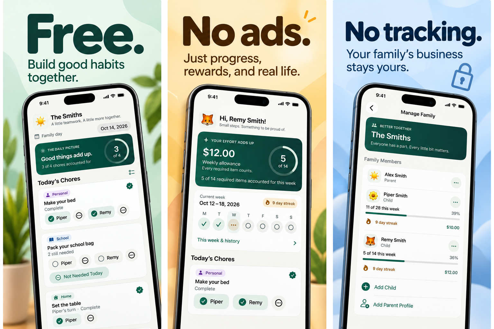

  

# Earned It

Private family chore tracking, built around iCloud. No accounts to create, no ads, no tracking, and your family data stays in your family’s iCloud.

Earned It keeps everyday responsibilities clear. Families can organize chores, let children mark their own work, and celebrate progress together in one simple app.

## What it does

- Shares family chore lists between parents and children.
- Provides parent and child roles with appropriate controls.
- Supports recurring weekday chores and as-needed chores.
- Assigns chores to every child, a particular child, or alternating children.
- Lets children agree to swap today's alternating turn for a sibling's next scheduled turn.
- Lets parents nudge children about unfinished chores.
- Keeps chore requests and family updates in Activity, with optional alerts and app icon badges.
- Lets children mark their own work while parents manage the family.
- Shows weekly progress and streaks.
- Optionally tracks weekly allowance eligibility without moving money.
- Supports parent-awarded [weekly bonuses](docs/family-polish.md#bonus-allowance).
- Shares through iCloud, synchronizes automatically, and works offline.

Parent and child homes stay on the bound person and do not expose Switch Profile. Store availability of the [next release](Configuration/Version.xcconfig) remains pending.

Still planned:

- As-needed chore history that shows who did a chore last.

## How families use it

A parent creates the family, adds children, and sets up chores. After saving a child, choose **Connect Now** to open their invitation or **Add Device Later** to continue setup. Parents can also invite family members from Manage Family. Each person sees the profile and controls intended for them.

Children check their list and mark chores complete. Parents manage the family name and assignments and follow the family's progress. Changes are saved on the device and synchronize when a connection is available.

The refreshed Today screens highlight daily chores, weekly progress, streaks, and allowance eligibility. On iPad, daily work and weekly context appear side by side; accessibility text sizes use a single column. Parents can open a child's progress from Today or review each child in Manage Family.

The parent's **Weekly progress** card starts on the current week. Swipe horizontally or use **Previous week** and **Next week** to review weeks labeled with their date range. Choose **Current week** to return, or open a child's card for the selected week's details. The [weekly history rules](docs/shared-household-architecture.md#allowance-and-history) describe the history window and how dated results are derived.

For an exchange, choose **Swap Turns** on today's alternating chore, select a sibling, and review the return date before sending. The sibling chooses **Accept Swap** or **No Thanks** in **Activity**, opened from the bell.

Parents can press **Nudge** beside unfinished work or open a child's progress and choose **Award Bonus**. See the [family progress and turn exchange guide](docs/family-polish.md) for eligibility, history, and exchange rules. Use Activity's **Notifications** card to turn alerts on or off; the [Activity guide](docs/punt-notifications.md#communication-coverage-and-privacy) explains privacy and delivery limits.

## Privacy

**Free. No ads. No tracking.**

Family data is stored locally on each device. When sharing is enabled, it is synchronized through Apple's iCloud and CloudKit infrastructure. Earned It has no advertising, behavioral analytics, third-party tracking, or third-party telemetry SDKs. The developer does not operate a separate server for family data.

Read the full [privacy policy](docs/app-store/privacy-policy.md) and [privacy audit](docs/app-store/privacy-audit.md).

## Requirements

- iPhone or iPad running iOS 18 or later
- An iCloud account and network connection for sharing between devices
- Optional camera access for scanning invitation QR codes

A family can also use Earned It locally on one iPhone or iPad without enabling sharing.

## Development

Open `EarnedIt.xcodeproj` in Xcode 26.6 or later. Use the `EarnedItCI` scheme for Simulator tests. Live iCloud sharing requires signed devices and separate iCloud accounts.

## Technical documentation

- [Technical overview](docs/technical-overview.md)
- [Shared household architecture and product rules](docs/shared-household-architecture.md)
- [Redesign and QA evidence](docs/premium-redesign.md)
- [App Store release readiness](docs/app-store/release-readiness.md)

The source is currently published without an open-source license. Public visibility does not grant permission to reuse, modify, or redistribute it.
