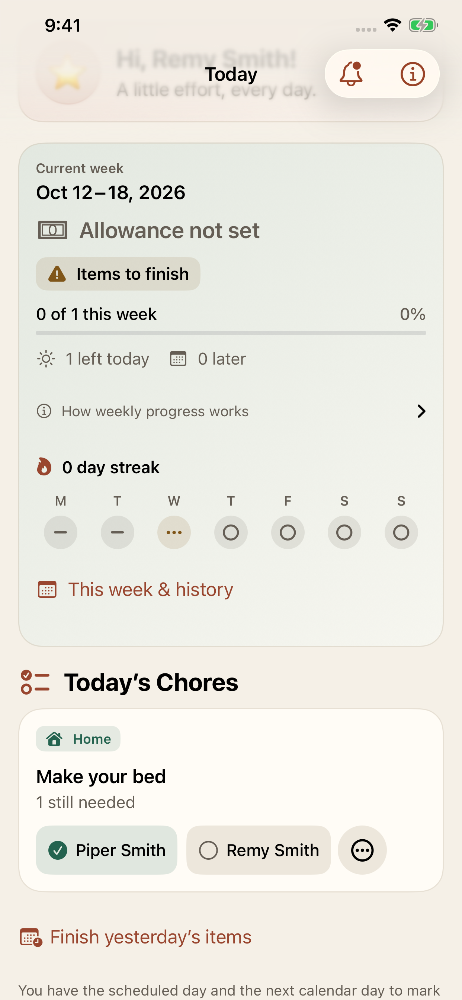
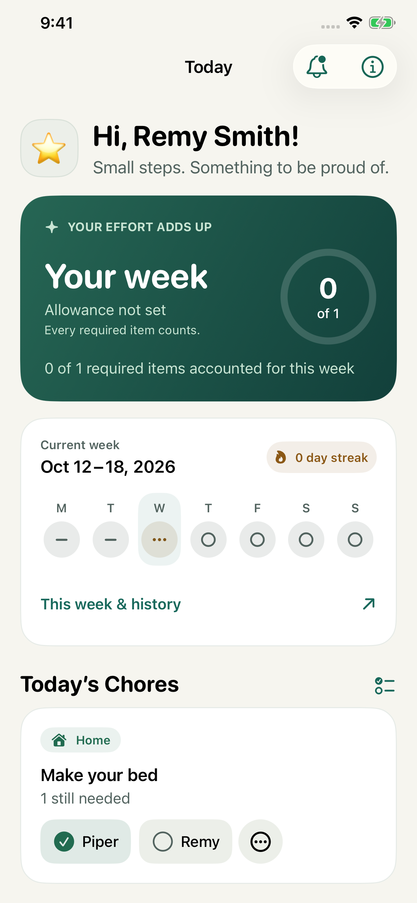

# Shared chore and role comparison

Both names on Remy's shared chore are expected existing behavior. The card is a
household chore with independent contributions, and Remy is one of its eligible
children. Piper's contribution is read-only on Remy's screen. Remy's own
contribution has the completion button and state menu. The redesign retains the
same visibility rule, permission check, mutation entry point, accessibility label,
and read-only value. It only abbreviates unique first names in the visible chips.

## Observation and expected behavior

The initiating trigger was opening the child home as Remy. The apparent symptom
was seeing both Piper and Remy in the same chore card. The relevant data condition
is an all-children chore, so both independent contributions matter. A particular
chore assigned only to Piper or an alternating occurrence owned by Piper follows
a different visibility path and is absent from Remy's list. Completion by Piper
does not complete Remy's own required item.

Expected behavior comes from the established pre-redesign app, the product rules,
and centralized permissions, rather than an assumption that child home must omit
all sibling context. Seeing a sibling does not give Remy that sibling's controls.
The child path cannot offer parent-only family/chore configuration or parent
correction states.

## Native counterfactual

The exact same observable `testChildChoreFunctionalEquivalence` flow ran against
tracked app source/assets from `bba5d4e314882d6bbc10094091ff8c79bd1db719` and the
redesign, using the same dedicated UI-test journal, fictional Smith names, current
calendar day, all-children task, Piper-only task, and alternating task initially
owned by Piper. The baseline app was built temporarily in this isolated task
worktree, with source bytes verified against that commit. The redesign files were
then restored byte-for-byte. No second checkout, real identity, production store,
CloudKit operation, or sibling nuke copy was used. Synthetic profile bindings exist
only in the disposable UI-test journal. The six marketing images use their
separate opt-in marketing journal without invitations or claims.

The hypothesis that redesign changed sibling permissions would be falsified by
identical read-only elements and unchanged state after tapping them in both apps.
That exact negative action is part of the flow. Changing only the invited child
from Remy to Piper is a second counterfactual: Piper receives her own particular
and alternating controls; Remy does not. Returning to Alex demonstrates the
parent's management and correction actions without transferring sibling credit.

| Observable action | Baseline | Redesign |
| --- | --- | --- |
| Alex sees family/chore management and both children's state buttons | Passed | Passed |
| Piper completes her bed; Remy's stays unmarked | Passed | Passed |
| Remy's header and persisted route identify Remy; no profile switcher or parent controls | Passed | Passed |
| Piper's shared contribution has value `View only`, no button, and no state menu | Passed | Passed |
| Tapping Piper's read-only chip changes neither child's state | Passed | Passed |
| Remy can mark, undo, and use Done in his own menu; no Missed or Not Needed Today actions | Passed | Passed |
| Remy's completion and bound child route persist on relaunch | Passed | Passed |
| Piper-only and Piper's alternating task are absent from Remy's list | Passed | Passed |
| Piper sees her own particular task and Your turn; no Remy state button for either | Passed | Passed |
| Piper completes her turn; Alex sees it and both independent bed outcomes | Passed | Passed |
| Alex undoes Remy's bed completion without changing Piper's | Passed | Passed |

The Smith marketing reproduction separately runs the existing premium native
flow: it opens Alex and Remy from the deterministic marketing journal, captures
the actual screens, completes only Remy's school bag, verifies Piper has no button
on Remy's screen, relaunches Remy to confirm Done, then launches Piper to confirm
her bag remains Unmarked. Its native accessibility audits remain enabled.

## Native comparison

These actual screenshots show the same inputs after the negative sibling tap.
Piper is complete, Remy is unmarked, and only Remy has the state menu. No overlay,
scaling, or cropping was applied. They are engineering evidence, separate from the
six marketing captures.

| Baseline at bba5d4e | Redesign |
| --- | --- |
|  |  |

## Scope and evidence

Baseline result: one focused execution passed, zero failures or skips.
Redesign comparison and isolated marketing reproduction: both focused executions
passed, zero failures or skips. No demonstrated redesign regression exists in
these reproduced paths. No behavior change or sibling-hiding change was made.
Evidence is under the authorized local task data directory's
`functional-equivalence/`, with source manifests, logs, result bundles, and actual
native screenshot attachments. The only additional app-repository code is the
observable XCTest flow and its optional-name setup helper. App, model, permission,
journal, transport, recurrence, allowance, and identity implementations were not
changed by this follow-up.

The bounded paths do not establish signed two-account CloudKit, APNs delivery, or
physical haptics. The subsequent no-mistakes run validates the wider protected
behavior through local tests and review. GitHub CI is explicitly excluded.
