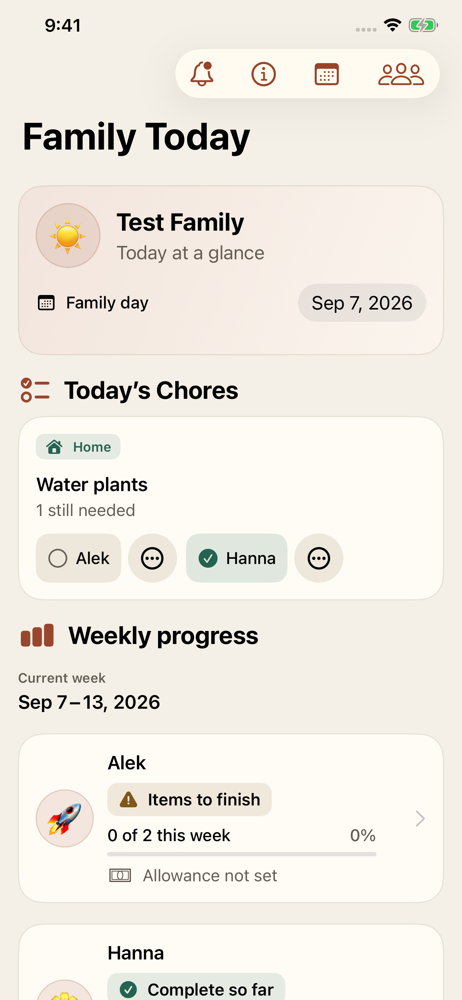
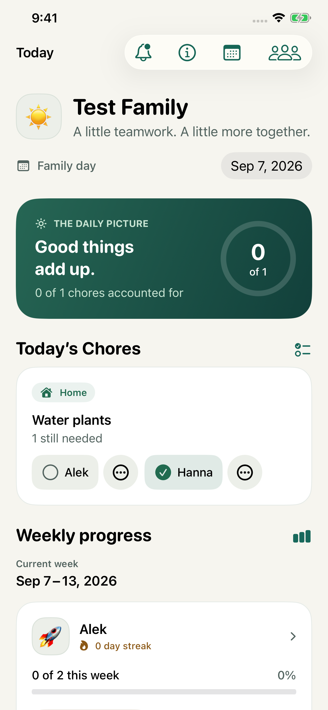
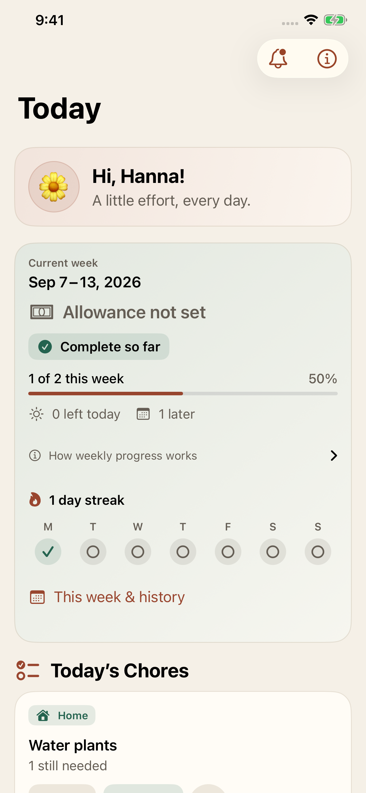
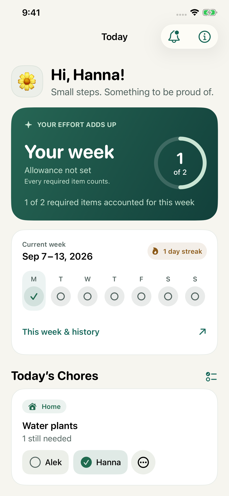

# Native before and after evidence

Both sides show the same existing weekly UI-test fixture on iPhone 11 Pro Max:
Test Family, September 7, 2026, with Hanna's Water plants completion recorded and
Alek's still unmarked. The baseline is origin/main at `bba5d4e`; the after captures
use the final redesigned 1.1.0 (54) app. These are actual native screenshots,
without mockups or overlays.

| Parent before | Parent after |
| --- | --- |
|  |  |

| Child before | Child after |
| --- | --- |
|  |  |

This engineering comparison uses the existing Test Family fixture to hold input
and date constant. The campaign source captures use The Smiths consistently and
are separate: [six marketing screenshots](../../marketing-assets/1.1.0/README.md).

A responsive comparison artifact was exported with Lavish under the authorized
local evidence directory:
`review/visual-review-portable.html`. It uses the app's own theme tokens and these
native screenshots. See [design and QA](../premium-redesign.md) for validation.
